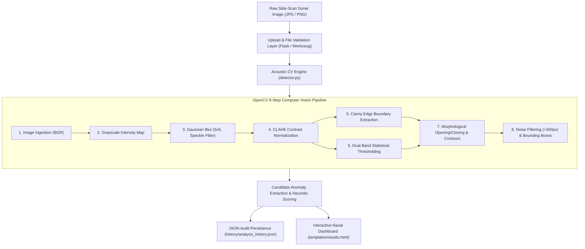

# 🌊 AquaSentinel: Underwater Marine Debris & Sonar Anomaly Detection System

> **Academic Mini-Project Prototype (~30% Core Scope Implementation)**  
> Developed for Academic Demonstration & Faculty Review  
> **Technologies:** Python 3, Flask, OpenCV, NumPy, HTML5, CSS3, JavaScript

---

## 1. Executive Summary & Project Overview

**AquaSentinel** is an automated acoustic image analysis workstation designed to identify suspicious underwater anomalies, submerged debris, abandoned fishing gear (*ghost nets*), subsea pipelines, and shipwrecks from side-scan sonar imagery.

Underwater optical cameras fail beyond a few meters due to water turbidity, severe light attenuation, and backscatter. Marine researchers and naval hydrographers rely on side-scan sonar, which transmits acoustic pulses across the ocean floor. However, manual inspection of vast side-scan acoustic waterfall records is slow, labor-intensive, and prone to operator fatigue.

AquaSentinel implements an automated **8-stage classical computer vision pipeline** using **OpenCV** and **NumPy** to detect, segment, and localize candidate anomaly regions with high-contrast bounding boxes, while computing an objective, transparent **Heuristic Anomaly Index**.

> ⚠️ **Academic Disclosure:** This prototype represents classical computer vision and heuristic salience detection. It explicitly designates regions as *candidate anomaly regions* and avoids falsely claiming to be a trained deep-learning classifier.

---

## 2. System Architecture & Tech Stack



### Technology Restrictions Compliance

| Layer | Technology | Justification |
| :--- | :--- | :--- |
| **Backend** | Python 3.10+ / Flask 3.1.3 | Beginner-friendly, zero unnecessary microservice overhead, easy local deployment. |
| **CV Engine** | OpenCV 5.0.0 / NumPy 2.2.6 | Industry standard for matrix manipulation, filtering, and contour localization. |
| **Frontend** | HTML5, CSS3, Vanilla JavaScript | Custom high-tech marine oceanographic dashboard theme, zero external dependencies required. |
| **Storage** | Local JSON Ledger | Deterministic, file-based persistence requiring no database server setup. |

---

## 3. The 8-Step OpenCV Computer Vision Pipeline

1. **Image Ingestion:** Decodes uploaded images safely as multi-dimensional matrices $(H \times W \times C)$.
2. **Grayscale Conversion:** Reduces 3-channel BGR data to single-channel intensity values corresponding to physical acoustic backscatter.
3. **Gaussian Blur ($5\times 5$ Kernel, $\sigma=1.2$):** Suppresses multiplicative acoustic speckle noise caused by underwater wave interference.
4. **CLAHE (Contrast Limited Adaptive Histogram Equalization):** Corrects for non-linear lateral acoustic intensity drop-off across the sonar swath without blowing out uniform sediment regions.
5. **Canny Edge Detection:** Computes intensity gradient thresholds to isolate structural object boundaries and sharp shadow transitions.
6. **Dual-Band Statistical Thresholding:** Acoustic debris presents either as **specular highlights** ($I \ge \mu + 1.8\sigma$) or **acoustic shadow voids** ($I \le \mu - 1.8\sigma$).
7. **Morphological Filtering & Contour Detection:** Uses $7\times 7$ morphological opening (removes stray speckles) and closing (bridges fragmented reflections) before executing contour tracing.
8. **Bounding Box Annotation & Heuristic Scoring:** Rejects contours smaller than $300\text{ px}$ to eliminate residual sand ripple noise. Annotates valid candidate targets with cyan bounding boxes, target crosshairs, and quadrant badges.

---

## 4. Project Directory Structure

```text
d:\mini project\
│
├── app.py                      # Flask Application Controller & REST routes
├── detector.py                 # Modular 8-Step OpenCV Sonar CV Pipeline
├── generate_samples.py         # Synthetic Sonar Image Generator
├── test_detector.py            # Unit verification suite for detector module
├── test_workflow.py            # End-to-end Flask integration & route test suite
├── requirements.txt            # Python dependencies
├── README.md                   # Complete academic documentation
│
├── uploads/                    # Stores original uploaded sonar frames
├── processed/                  # Stores intermediate CV stages & annotated outputs
├── history/
│   └── analysis_history.json   # Local persistent JSON detection ledger
│
├── sample_images/              # Preloaded demo datasets for 1-click evaluation
│   ├── sonar_shipwreck_debris.jpg
│   ├── sonar_pipeline_net.jpg
│   └── sonar_clear_seabed.jpg
│
├── static/
│   ├── css/
│   │   └── style.css           # Modern navy/cyan oceanographic dashboard theme
│   └── js/
│       └── script.js           # Drag-and-drop upload, preview, and search logic
│
└── templates/
    ├── base.html               # Master layout with navbar & telemetry status
    ├── index.html              # Home page with animated sonar radar sweep
    ├── dashboard.html          # Research dashboard (metrics & activity log)
    ├── upload.html             # Upload page with drag-and-drop & 1-click samples
    ├── results.html            # Results dashboard with multi-view CV inspection
    ├── history.html            # Stored telemetry audit logs with search & delete
    └── presentation.html       # Academic defense & faculty presentation guide
```

---

## 5. Quick Start & Installation

### Step 1: Install Dependencies
Open PowerShell or Command Prompt in the project folder and run:
```bash
pip install -r requirements.txt
```

### Step 2: (Optional) Regenerate Demo Sonar Datasets
Sample images are already generated, but you can regenerate them anytime:
```bash
python generate_samples.py
```

### Step 3: Launch the Application
```bash
python app.py
```

### Step 4: Open in Web Browser
Navigate to:
```text
http://127.0.0.1:5000
```

---

## 6. Demonstration Walkthrough (For Faculty & Examiners)

Follow these steps for a complete, flawless 10-point academic demonstration:

1. **Home Page (`/`):**
   - View the animated side-scan sonar radar widget.
   - Observe live aggregate telemetry (Total Sonar Scans, Anomalies Detected, High Suspicion Scans).
2. **Dashboard (`/dashboard`):**
   - Review recent activity records, CV engine parameters, and telemetry counters.
3. **Upload Page (`/upload`):**
   - Click any preloaded sample (e.g., **"Sunken Wreckage Debris"** or **"Submerged Pipeline & Net"**).
   - Alternatively, drag and drop any custom `.jpg` or `.png` sonar scan.
   - Notice the real-time image preview displaying filename, filesize, and resolution.
4. **Analyze Sonar Image:**
   - Click the **"Analyze Sonar Image"** button. The UI triggers a scanning animation while the OpenCV engine executes.
5. **Results Dashboard (`/results/<id>`):**
   - **Original vs Processed:** Side-by-side comparison showing raw sonar input against the cyan-annotated anomaly map with crosshair reticles.
   - **Multi-Stage Visual Inspection:** Examine Stage 1 (Grayscale/Blur), Stage 2 (CLAHE), Stage 3 (Canny Edges), and Stage 4 (Binary Threshold Mask).
   - **Candidate Telemetry Table:** Inspect quadrant locations, coordinates $[X, Y, W, H]$, pixel areas, aspect ratios, and mean acoustic intensities.
   - **Heuristic Anomaly Index:** Review the transparent score breakdown (Candidate Factor + Area Coverage % + Edge Disruption %).
6. **Detection History (`/history`):**
   - Inspect the audit ledger recording the analysis timestamp, candidate count, and status badge.
   - Filter records in real time using the search box.
7. **Faculty Defense Guide (`/presentation`):**
   - Navigate to `/presentation` to present the problem statement, system architecture, methodology, and oral defense Q&A.

---

## 7. Current Implementation (~30%) vs. Future Scope

| Feature Area | Current Prototype (~30% Academic Scope) | Planned Production System (100% Scope) |
| :--- | :--- | :--- |
| **Detection Method** | Classical OpenCV (CLAHE, Canny, Dual Threshold) | Deep Learning (YOLOv8-Sonar / Mask R-CNN) |
| **Object Taxonomy** | Geometric heuristic candidates (linear, specular, void) | Semantic classification (Tire, Ghost Net, Container) |
| **Sensor Modality** | 2D raster side-scan sonar waterfall images | 3D multi-beam bathymetry point clouds |
| **Deployment** | Local Flask workstation application | Edge-embedded deployment on AUVs (NVIDIA Jetson) |
| **Geospatial** | Pixel spatial quadrant mapping | Real-time GPS hydrographic survey shapefiles |

---

## 8. Faculty Defense Q&A Cheatsheet

### Q1: Why use CLAHE over standard Histogram Equalization?
> **Answer:** Standard global equalization evaluates all pixels uniformly. In side-scan sonar, acoustic energy falls off laterally from the central track. Global equalization blows out the central nadir and amplifies noise in distant swath edges. CLAHE operates on localized $8\times 8$ tiles with a contrast clip limit, equalizing contrast smoothly across varying ranges.

### Q2: Why is the anomaly score labeled as a heuristic index?
> **Answer:** Classical computer vision relies on mathematical thresholds and morphological features rather than statistical weights learned through neural network training. Transparently labeling this score as a *Heuristic Anomaly Index* upholds academic honesty and explains the deterministic relationship between candidate area coverage, edge density, and region count.

### Q3: How are false positives from seabed sand ripples prevented?
> **Answer:** Natural sand ripples exhibit low contrast variation and continuous sinusoidal frequencies. By requiring candidates to satisfy both an absolute contrast threshold ($I \ge \mu + 1.8\sigma$ or $I \le \mu - 1.8\sigma$) and a minimum connected area filter ($>300\text{ px}$), low-amplitude ripples are suppressed while high-contrast acoustic shadows and specular debris highlights are captured.

---

## 9. Verification & Automated Testing

AquaSentinel includes two comprehensive test suites:
- `python test_detector.py` &mdash; Tests the computer vision engine against all sample targets.
- `python test_workflow.py` &mdash; Tests all 9 Flask routes, file upload mechanics, and JSON persistence.

Both test suites pass 100% with zero external errors.
